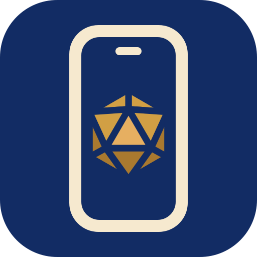

#  Mobile Deck

[](https://github.com/EdenMichal/mobile-deck/releases/latest)


[](LICENSE)

**Your Foundry game, designed for touch.**

Mobile Deck gives **D&D5e** and **Pathfinder Second Edition** a phone and tablet interface. Open your usual Foundry world in a browser and sign in. You can roll, cast spells, manage gear, read journals, follow chat and move tokens. Rolls and actions still go through your game system.

Mobile Deck is a fork of [VE Mobile](https://github.com/Silvestrae/ve-mobile) by Silvestrae. The phone and tablet interface is Silvestrae's work. This fork adds:

- **Character Builder (D&D5e).** Level up, create a new character and choose spells on your phone, with the GM's choice of compendiums, books and house rules. A GM can approve players' level-ups and new characters.
- **Player items.** Create and delete items from the Inventory tab.
- **Party inventory.** Send, take, deposit and withdraw items and coins through a D&D5e Group actor, with every move run on the GM's client.

To install, paste this manifest URL into Foundry's **Add-on Modules > Install Module** ([details below](#install-and-start-playing)):

```text
https://github.com/EdenMichal/mobile-deck/releases/latest/download/module.json
```

Mobile Deck is a separate module with its own ID, `mobile-deck`. It doesn't read VE Mobile's settings, so set it up fresh, and don't run both in the same world.

## Contents

- [Compatibility](#compatibility)
- [Devices and support](#devices-and-support)
- [Install and start playing](#install-and-start-playing)
- [Install as an app (PWA)](#install-as-an-app-pwa)
- [Phone and tablet layouts](#phone-and-tablet-layouts)
- [Dungeons & Dragons Fifth Edition](#dungeons--dragons-fifth-edition)
- [Pathfinder Second Edition](#pathfinder-second-edition)
- [Controls and shortcuts](#controls-and-shortcuts)
- [Scene and token movement](#scene-and-token-movement)
- [Chat, journals, and combat](#chat-journals-and-combat)
- [Appearance and performance](#appearance-and-performance)
- [Localisation](#localisation)
- [Troubleshooting](#troubleshooting)
- [Feedback and support](#feedback-and-support)
- [License and credits](#license-and-credits)

## Compatibility

| Game system | Minimum requirements |
| --- | --- |
| **D&D5e** | Foundry 13 and D&D5e 5.3.2 |
| **PF2e** | Foundry 14 and PF2e 8.6.1 |

**PF2e requires Foundry v14+.** Other game systems are not currently supported.

## Devices and support

Performance depends on your device, browser, world and modules.

iPhone and iPad support is best effort. Foundry lists Safari as unsupported, and switching browsers on iOS may still use WebKit. If the map is unstable, try a lighter graphics profile or play with the canvas disabled. [Foundry's browser requirements](https://foundryvtt.com/article/requirements/)

## Install and start playing

1. In Foundry Setup, open **Add-on Modules > Install Module**. Paste this into **Manifest URL** and select **Install**.

   ```text
   https://github.com/EdenMichal/mobile-deck/releases/latest/download/module.json
   ```

2. Enable **Mobile Deck** in **Manage Modules** and fully reload Foundry.
3. Open the world on your phone or tablet. Use **Auto-detect** or pick **Phone** or **Tablet** in **Mobile Mode**.

<details>
<summary>Manual installation</summary>

Extract the ZIP from the [latest release](https://github.com/EdenMichal/mobile-deck/releases/latest) into `Data/modules/mobile-deck`. Put `module.json` directly in that folder, beside `src`, `assets` and `locales`, then reload Foundry.

</details>

## Install as an app (PWA)

On Android Chrome or Edge, sign into your world over HTTPS and open **Settings > Device & Power > Install app**. Keep the world name or enter your own. If the button is missing, look in the browser menu for **Install app** or **Add to Home screen**.

On iPhone or iPad, use **Share > Add to Home Screen** in Safari. Your Foundry server still needs to be reachable when you play.

## Phone and tablet layouts

| Layout | How it works |
| --- | --- |
| **Phone** | One pane at a time, with navigation along the bottom. |
| **Tablet Split** | The live map beside your sheet, chat or journal. |
| **Tablet Full** | One wide pane with navigation along the side. |

Use **Split Screen** to switch between the two tablet layouts.

## Dungeons & Dragons Fifth Edition

- **Characters and NPCs** have their own sheets with stats, inventory, spells and actions. Tap a row for details and use the action buttons to roll or cast.
- **Groups** show members, shared supplies and travel details. Open a member's sheet and return to the group when you're done.
- **Vehicles** show movement, stations, components and cargo. Use the available system actions from the sheet.

- **Character Builder** opens from the Level up button in the character header, or from **New character** in the actor chooser. GMs choose the allowed compendiums, books and house rules in the module settings.
- **Inventory** has a **+** to create an item and **Delete** in each item's menu. **Send to Party** and the Party page move items and coins through the world's D&D5e Group actor.

Use **Native configuration & edit** when you need the standard Foundry sheet.

## Pathfinder Second Edition

**PF2e is a community test integration for existing player characters on Foundry v14+.** If a roll, resource cost or condition looks wrong, say what you expected on the standard PF2e sheet. [Report a PF2e issue](https://github.com/EdenMichal/mobile-deck/issues).

### What you can do

- Roll checks, saves and attacks, including multiple attack penalties. Manage conditions, persistent damage, shields and supported class resources.
- Manage prepared spells and cast from your sheet, including supported rituals, scrolls and wands.
- Use the Crafting tab for formulas, crafting checks and supported alchemy. The Pathfinder Society tab covers character details, factions, reputation and boons.

The actor chooser lists player characters. Character creation, advancement, Society reporting and full staff preparation and charges are outside the current scope. Specialist class and third-party mechanics vary.

## Controls and shortcuts

Tap the character header chevron to switch actors. Tap rows to read details, or use the roll and cast buttons to act. Hold supported items or skills for shortcuts. The **Character Quickbar** follows the selected actor, and the **Foundry Hotbar** uses your macros.

For holds, placement and other shortcuts, open **Settings > Support > Controls & Gestures**.

## Scene and token movement

Drag to pan and pinch to zoom. Tap an owned token to select it, double-tap a visible token to target it, or hold an owned token for its controls. GMs can double-tap the **Scene** tab to pause or unpause.

Choose **Joystick** or **D-pad** in **Settings > Scene & Controls > Movement control**. Drag the joystick from its centre, or tap the D-pad to move one step at a time. The D-pad has six directions on hex grids and eight on square or gridless scenes. Foundry still handles walls, ownership and movement rules.

Turn on **Return to Scene after actions** if you want supported actions to bring you back to the map in Phone or Tablet Full.

## Chat, journals, and combat

- **Chat** keeps your system's roll cards and messages, with an unread badge that clears when you reach the newest message.
- **Journals** show folders and pages. Pinch to change text size, or open an image to zoom in.
- **Combat** shows the turn order and the controls your role allows. The optional carousel keeps the order and **End Turn** on the map.

## Appearance and performance

Choose light, dark or system appearance and adjust class colours in **Settings > Appearance**.

Go to **Settings > Appearance > Character header artwork** to pick **Procedural SVG** for a scene based on the actor's class and name, **Custom** for your own image, or **Off**. Off is the default and shows the class colours only. You can set a custom image for one actor or use the same image across all actors on your account.

For demanding maps, try a lighter graphics profile in **Performance & Memory**. GMs can use the **Mobile Asset Optimizer** to make smaller copies of scene images. **Disable game canvas** keeps sheets, chat and journals available. Map actions and some automation still need the canvas.

## Localisation

Mobile Deck ships with **US English, Australian English and Russian**. Thanks to [Mokudgo](https://github.com/Mokudgo) for translating and testing Russian for VE Mobile. The Character Builder is English only for now. Mobile Deck uses English where it doesn't have a translation.

## Troubleshooting

| Problem | What to try |
| --- | --- |
| An update is missing | Fully reload Foundry and check the installed version. |
| An actor or action is missing | Check ownership, the selected actor or token, and system support. |
| A session looks stale | Try reconnect or resync, then **Reload Foundry**. |
| The map is slow or crashes | Try a lighter graphics profile or disable the game canvas. |
| A native screen needs more space | Switch to **Desktop** in **Mobile Mode**. |

## Feedback and support

If something breaks, describe what you did, what you expected and what happened. Include your device, browser, Foundry, system and Mobile Deck versions, plus any relevant modules. [Report a bug or suggest a feature](https://github.com/EdenMichal/mobile-deck/issues).

Please report Mobile Deck problems here rather than to VE Mobile.

## License and credits

Mobile Deck's code is under the [MIT Licence](LICENSE). It is based on [VE Mobile](https://github.com/Silvestrae/ve-mobile), © 2026 Silvestrae, also under the MIT Licence. If you enjoy the interface, you can [support Silvestrae on Ko-fi](https://ko-fi.com/silvestrae).

The bundled Work Sans font (`assets/fonts`) is © 2019 The Work Sans Project Authors and is licensed under the [SIL Open Font License 1.1](https://openfontlicense.org).

I use AI tools to assist with writing code, documentation and testing. [Foundry VTT AI Content Policy](https://foundryvtt.com/article/ai-policy/)

Mobile Deck is independent of Foundry Gaming LLC, Wizards of the Coast and Paizo.
